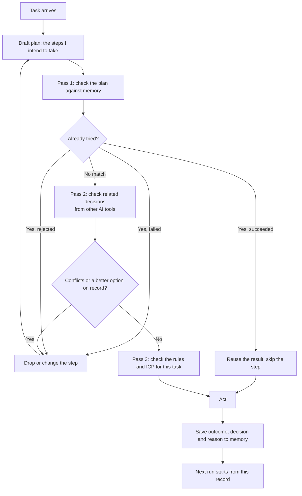

# How VILIXAI memory shapes an AI's decisions

VILIXAI is a cloud memory layer over MCP. Any connected AI tool reads it before it acts and writes to it after. This page explains the loop, the passes around it, and how scheduled jobs use it.

Labels: **[Shipped]** is how the memory works today. **[Planned]** is the planning loop we are building toward. It is not yet a shipped feature.

---

## 1. The basic loop [Shipped]

1. **Read at the start.** The AI calls the memory tools before doing anything. It gets the recent messages and related past turns.
2. **Act.** The AI does the work with that context.
3. **Write at the end.** The AI saves what it did, what it decided, and what happened.

Each connected AI gets its own permissions. Full conversations are stored. Memory can be exported or deleted at any time.

---

## 2. The planning loop [Planned]

Before acting, the AI states its plan and checks it against memory:

### What each pass does

- **Pass 1: the plan against memory.** If the same step already failed, was rejected, or was superseded, the AI does not repeat it. Example: an agent planned to retry a scraper that failed on three earlier runs. It sees the record and tries a different route.
- **Pass 2: the plan against other tools.** The check covers all connected AIs, not only the one running. Example: a chat assistant rejected a vendor on Monday. The scheduled agent on Tuesday sees the rejection and skips that vendor.
- **Pass 3: the plan against the rules.** The AI checks the task against standing rules and the target customer profile before acting. This keeps a scheduled job from drifting from its brief.

A decision that matches nothing in memory is new. It gets written down after it is made.

---

## 3. Scheduled jobs use the same memory [Shipped]

A scheduled job does not need a long prompt. It needs a short instruction and access to memory.

**Short job brief (what you write):**
> Post a feedback request about VILIXAI in this week's subreddit list. Keep the rules in mind.

**What the job reads at the start:**
- recent messages and related turns about VILIXAI
- saved rules and the target customer profile
- what earlier runs posted, and what they were told to avoid

The brief stays short, and the job still knows the product, the subreddit rules, and the audience. The planning loop in section 2 is what will make the job check its plan against past failures before posting.

---

## 4. What this means in practice

- **Less repeated work.** A decision made once is available to every connected tool.
- **Fewer repeated failures.** Dead ends and rejected options are on record, so they are not retried.
- **Shorter prompts.** Jobs do not need every detail in the brief, because the context is already in memory.
- **Auditable.** Full conversations are stored and can be exported or deleted at any time.
